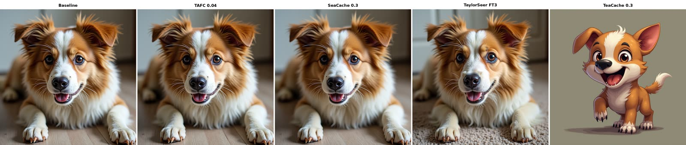
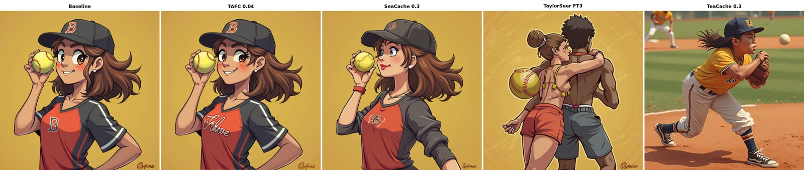
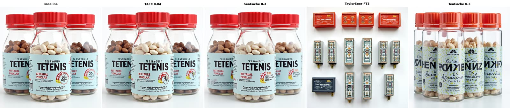

# TAFC for FLUX
This is the official implementation of TAFC for FLUX.

## Installation

This script relies on PyTorch, Diffusers, and common Hugging Face tooling.

```bash
pip install --upgrade \
    diffusers[torch] \
    transformers \
    protobuf \
    tokenizers \
    sentencepiece \
    accelerate \
    safetensors

huggingface-cli login   # FLUX.1-dev is a gated model
```

Keep `tafc_generate.py`, `util_tafc.py` and `bench_common.py` in the same directory and run from there.

For benchmark evaluation you additionally need:
- `run_drawbench_eval.py`, `eval_drawbench.py`, `summarize_drawbench.py` (DrawBench)
- `run_hpsv3_eval.py`, `eval_hpsv3.py` (HPSv3)
- `flux_generate.py` (no-cache baseline) and `seacache_generate.py` (+ `util_seacache.py`) from the [SeaCache](https://github.com/jiwoogit/SeaCache) repo, if you want the `baseline` and `seacache_<thresh>` configs
- the prompt files `benchmarks/drawbench.csv` and `benchmarks/hpsv3_benchmark.json`

## Usage

The main code is `tafc_generate.py`.

```bash
python tafc_generate.py --prompt_file prompts.txt --output_dir ./tafc_results
```

### Custom Prompts and Output Directory

```bash
cat > prompts.txt << EOF
a high-resolution photo of a panda drinking coffee in a cozy cafe
a beautiful sunset over the ocean
EOF

python tafc_generate.py \
  --prompt_file prompts.txt \
  --output_dir ./tafc_results \
  --width 1024 --height 1024 \
  --num_inference_steps 50 \
  --seed 0 \
  --tafc_thresh 0.15
```

Arguments:
- `--prompt_file`: text file, one prompt per line
- `--output_dir`: directory to store generated images
- `--width` / `--height`: image size (default `1024`)
- `--num_inference_steps`: number of sampling steps (default `50`)
- `--guidance`: guidance scale (default `3.5`)
- `--seed`: random seed
- `--model_name` / `--model_id`: model preset (`flux-dev`, `flux-schnell`) / custom Hugging Face id
- `--offload`: CPU offload to save VRAM
- `--tafc_thresh`: base curvature threshold, controls the cache ratio (lower = stricter)
- `--tafc_max_cache`: consecutive-cache budget at the last step (default `6.0`, ramps from 1)
- `--use_ret_steps`: force-compute the first 5 steps
- `--log_interval`: print diagnostics every N steps (`0` disables)

> **Note:** You can sweep over `tafc_thresh` to find the balanced quality-latency trade-offs.
> FLUX uses guidance distillation, so the transformer is called once per step and a single cached residual stream suffices.

### Closed-loop (PID) arguments

| flag | default | meaning |
|---|---|---|
| `--tafc_no_pid` | off | disable the closed loop (A/B baseline) |
| `--tafc_e_target` | 0.0 | absolute error target; 0 = auto-calibrate |
| `--tafc_auto_tol` | 2.5 | tolerated multiple of the one-step baseline |
| `--tafc_reject` | 3.0 | hard veto above this multiple of the budget |
| `--tafc_kp` / `--tafc_ki` / `--tafc_kd` | 0.4 / 0.05 / 0.2 | PID gains |
| `--tafc_gain_min` / `--tafc_gain_max` | 0.3 / 3.0 | clamps on the budget multiplier |
| `--tafc_brake_beta` | 2.0 | feedforward brake strength (0 disables) |
| `--tafc_brake_floor` | 0.3 | hardest the brake may squeeze the budget |
| `--tafc_calib_steps` | 3 | forced single-step computes before caching is allowed |

---
## Benchmark Evaluation
We follow the [SeaCache](https://github.com/jiwoogit/SeaCache) protocol: generate benchmark images with the no-cache baseline and each setting, compute fidelity (PSNR / SSIM / LPIPS) against the baseline, and quality / preference scores with the benchmark's own metrics.

Configs are named `baseline`, `tafc_<thresh>[_ret]` (`_ret` adds `--use_ret_steps`) and `seacache_<thresh>`.

> **Note:** HPSv3 pins `transformers==4.45.2` (Qwen2-VL), which conflicts with the generation / pyiqa environment. Use a separate conda environment (e.g. `hpsv3`) for HPSv3 scoring.

### 1. DrawBench (200 prompts)

Generate samples. Each config is one process that loops over the whole benchmark, so the pipeline is loaded only once.

```bash
# all default configs, sequentially
python run_drawbench_eval.py \
    --out_dir ./eval_samples \
    --configs baseline seacache_0.3 tafc_0.04 tafc_0.15 tafc_0.3

# quick smoke test
python run_drawbench_eval.py --num_prompts 4 --configs baseline tafc_0.15

# one config per GPU, in parallel
CUDA_VISIBLE_DEVICES=0 python run_drawbench_eval.py --configs baseline &
CUDA_VISIBLE_DEVICES=1 python run_drawbench_eval.py --configs tafc_0.15 &

# split one config across GPUs
CUDA_VISIBLE_DEVICES=0 python run_drawbench_eval.py --configs tafc_0.15 --shard 0 --num_shards 2 &
CUDA_VISIBLE_DEVICES=1 python run_drawbench_eval.py --configs tafc_0.15 --shard 1 --num_shards 2 &
```

Outputs:

    eval_samples/<config>/0000.png ... 0199.png
    eval_samples/<config>/gen_stats.json    # per-image latency and cache rate

Existing images are skipped by default, so interrupted runs can be resumed (`--no_skip_existing` to regenerate, `--dry_run` to print the commands).

Fidelity against the baseline (PSNR / SSIM / LPIPS):

```bash
python eval_drawbench.py \
    --gt_dir eval_samples/baseline \
    --gen_dir eval_samples/tafc_0.15
```

Add prompt alignment and human preference (CLIP score, ImageReward) and a no-reference quality metric:

```bash
python eval_drawbench.py \
    --gt_dir eval_samples/baseline \
    --gen_dir eval_samples/tafc_0.15 \
    --prompt_file benchmarks/drawbench.csv \
    --metrics psnr ssim lpips clip_score image_reward topiq_nr
```

The baseline has no reference, so score it with no-reference metrics only:

```bash
python eval_drawbench.py \
    --gen_dir eval_samples/baseline \
    --prompt_file benchmarks/drawbench.csv \
    --metrics clip_score image_reward topiq_nr
```

Collect latency, cache rate and quality of all configs into one table (speedup is relative to `baseline`):

```bash
python summarize_drawbench.py --out_dir eval_samples
python summarize_drawbench.py --out_dir eval_samples --json_out summary.json
```

### 2. HPSv3

`run_hpsv3_eval.py` is the HPSv3 sibling of the DrawBench driver (same configs, same layout). The full benchmark has 12,000 prompts (12 categories x 1,000); the default is the first 1,200 (100 per category, still category-balanced).

Generate samples:

```bash
# default subset (1,200 prompts)
python run_hpsv3_eval.py \
    --out_dir ./eval_samples_hpsv3 \
    --configs baseline seacache_0.3 tafc_0.04 tafc_0.15 tafc_0.3

# smoke test: one prompt per category
python run_hpsv3_eval.py --num_prompts 12 --configs baseline tafc_0.15

# full 12,000-prompt benchmark
python run_hpsv3_eval.py --num_prompts 0

# one config per GPU, in parallel
CUDA_VISIBLE_DEVICES=0 python run_hpsv3_eval.py --configs baseline &
CUDA_VISIBLE_DEVICES=1 python run_hpsv3_eval.py --configs tafc_0.15 &
```

Outputs:

    eval_samples_hpsv3/<config>/0000.png ... 1199.png
    eval_samples_hpsv3/<config>/gen_stats.json

Fidelity (PSNR / SSIM / LPIPS) uses the same script as DrawBench, in the generation environment:

```bash
python eval_drawbench.py \
    --gt_dir eval_samples_hpsv3/baseline \
    --gen_dir eval_samples_hpsv3/tafc_0.15
```

HPSv3 score, inside the `hpsv3` environment. This requires [HPSv3](https://github.com/MizzenAI/HPSv3) to be installed. The 16 GB reward model takes ~2 min to load, so score several configs in one call:

```bash
conda activate hpsv3

python eval_hpsv3.py \
    --gen_dir eval_samples_hpsv3/baseline \
              eval_samples_hpsv3/tafc_0.15 \
    --prompt_file benchmarks/hpsv3_benchmark.json \
    --batch_size 8
```

Per-category means and the unweighted 12-category OVERALL are reported. To split scoring across GPUs, use `--shard` / `--num_shards`, then merge:

```bash
CUDA_VISIBLE_DEVICES=0 python eval_hpsv3.py --gen_dir eval_samples_hpsv3/tafc_0.15 --shard 0 --num_shards 2 &
CUDA_VISIBLE_DEVICES=1 python eval_hpsv3.py --gen_dir eval_samples_hpsv3/tafc_0.15 --shard 1 --num_shards 2 &
wait
python eval_hpsv3.py --merge_shards eval_samples_hpsv3/tafc_0.15
```

### 3. Latency and cache rate
Latency and cache rate are read from `gen_stats.json` (printed by `summarize_drawbench.py`). TFLOPs and speedup are computed relative to the `baseline` config.

---
## Reproducing the Paper Results
FLUX.1-dev, 1024×1024, 50 steps, guidance 3.5, seed 42, DrawBench (200 prompts). The three TAFC operating points of the paper use a different `--tafc_max_cache`, so run them as separate invocations (the driver applies one `--tafc_max_cache` to all configs of a run). None of them use `--use_ret_steps`.

| Speedup | Config | `--tafc_max_cache` | `--warmup_steps` |
|:--:|:--:|:--:|:--:|
| ~2× | `tafc_0.04` | 1.0 | 5 |
| ~3× | `tafc_0.15` | 4.0 | 0 |
| ~4× | `tafc_0.3` | 6.0 | 0 |

    # no-cache reference (GT for PSNR / SSIM / LPIPS)
    python run_drawbench_eval.py --configs baseline --out_dir eval_samples

    # ~2x
    python run_drawbench_eval.py --configs tafc_0.04 --tafc_max_cache 1.0 --warmup_steps 5 --out_dir eval_samples
    # ~3x
    python run_drawbench_eval.py --configs tafc_0.15 --tafc_max_cache 4.0 --out_dir eval_samples
    # ~4x
    python run_drawbench_eval.py --configs tafc_0.3  --tafc_max_cache 6.0 --out_dir eval_samples

Then score and summarize as described in the Benchmark Evaluation section:

    python eval_drawbench.py --gt_dir eval_samples/baseline --gen_dir eval_samples/tafc_0.15
    python summarize_drawbench.py --out_dir eval_samples

> **Note:** Latency depends on the GPU, so absolute times will differ from the paper; PSNR / SSIM / LPIPS and cache rates are the comparable quantities. The closed-loop (PID) arguments are left at their defaults.

---
## Inference Results
Latency may vary depending on your GPU.

> **Note:** `tafc_thresh = δ`

### Qualitative samples (DrawBench)

Each image is a side-by-side comparison of the original FLUX.1-dev output and the cached results (DrawBench prompts 0087, 0105, 0104).








FLUX.1-dev, 1024×1024, 50 steps, HPSv3 evaluation:

| Method | Latency ↓ | TFLOPs ↓ | PSNR ↑ | SSIM ↑ | LPIPS ↓ | HPSv3 ↑ |
|:--|--:|--:|--:|--:|--:|--:|
| Original (50 steps) | 20.90s | 1668 | - | - | - | 10.6060 |
| TAFC (δ = 0.04) | 9.37s | 703 | 29.87 | 0.941 | 0.051 | 10.6623 |
| TAFC (δ = 0.15) | 5.94s | 451 | 21.35 | 0.820 | 0.196 | 10.8605 |
| TAFC (δ = 0.30) | 4.61s | 327 | 19.41 | 0.792 | 0.240 | 10.9129 |
